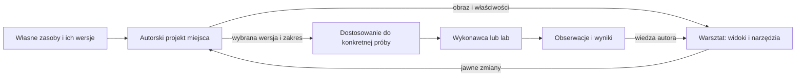

# Pierwsza sesja Feniks Studio

**Aktualizacja 16 października:** [rozpoznanie wspólnego warsztatu](../../research/2026-10-16-wspolny-warsztat.md) otwiera ponownie miejsce pierwszej sesji i wybór hosta. Plan z 15 października jest wstrzymany na prośbę Ownera. Poniższy dokument zachowuje intencje i propozycję doświadczenia; nie zatwierdza osobnej aplikacji.

**Status: propozycja Astry do oceny, 14 października 2026.** To projekt doświadczenia i granic odpowiedzialności. Nie stanowi jeszcze zatwierdzonego zakresu wydania, specyfikacji formatu ani planu implementacji. Dalsze odkrycia i używanie mogą go zmienić.

**Dalszy krok, 15 października:** po poleceniu kontynuacji opracowano [konkretny plan wykonania wariantu A](../plans/2026-10-15-pierwsza-sesja-studio.md). Dokument poniżej pozostaje źródłem intencji i granic; plan wybiera pierwszy host, zakres importu i sprawdziany. Oba czekają na ocenę zakresu przed implementacją.

## 1. Po co powstaje Studio

Owner chce sam tworzyć mapę, miejsca, rzeczy i ich wygląd oraz eksperymentować z tym, co się w świecie dzieje. Agenci mają dostarczać mechanizmy, narzędzia i techniczne wsparcie. Ważny wynik ich pracy to możliwość wykonania następnej podobnej czynności bez ponownego zlecania jej agentowi.

Grafika powstaje głównie poza Studio. Tutaj ma być łatwo użyć własnych materiałów, połączyć je w autorskie miejsce, rozwijać znaczenie rzeczy i rozumieć skutki zmian. Warsztat również należy do autora: ważne edytory mogą współistnieć, a układ można dostosować do czynności i później odzyskać.

Mapa i edytor mają wyprzedzać obecne laby. Nie znamy jeszcze przyszłych reprezentacji ciał, materialności, zasobów, pojemników czy zachowań. Potrzebujemy możliwości stopniowego dodawania nowych dziedzin bez oddawania jednemu eksperymentowi kontroli nad całym projektem.

Te potrzeby wynikają z wypowiedzi Ownera. Poniższy wybór pierwszej sesji jest **propozycją prowadzącej**, skonfrontowaną z niezależnym odczytem potrzeb przez Lunę 6 i alternatywami Sol 6.1. Zgoda agentów nie zastępuje oceny Ownera.

## 2. Dwa sensowne początki

| Sprawdzian | A — pracownia własnego miejsca | B — pracownia własnej sytuacji |
|---|---|---|
| Co powstaje | Miejsce z własnych materiałów, możliwe do przebudowy i dalszego używania. | Miejsce oraz rzeczywista próba wybranego mechanizmu. |
| Zmiana pomysłu | Autor zmienia układ, zachowuje alternatywę i wraca do wybranej wersji. | Robi to samo, a dodatkowo rozróżnia powtórzenie poprzedniej próby od uruchomienia poprawionego projektu. |
| Nowy lab lub rodzaj ciała | Otrzymuje odrębne dostosowanie projektu; nie ogranicza wcześniejszego autorstwa. | Potrzebuje własnej konfiguracji wykonania i wyjaśnienia różnic względem poprzedniej próby. |
| Największa korzyść | Szybciej oddaje autorowi codzienną pracę nad mapą i miejscami. | Wcześniej sprawdza związek między układaniem świata a jego działaniem. |
| Największe ryzyko | Zatrzymanie się na prezentacji sceny albo samym przesuwaniu gotowych modeli. | Przejęcie modelu jednego wykonawcy oraz odsunięcie edytora do czasu gotowej symulacji. |

**Rekomenduję A jako pierwszy spójny zakres.** Samodzielne autorstwo ma już wartość. B pozostaje mocną alternatywą, jeżeli najpilniejszą potrzebą okaże się konkretna próba materialna. Nie wybieramy przez A docelowo nieruchomego świata ani zakazu zachowań.

Początek od samego systemu paneli nie wystarczy: swobodne okna potrzebują prawdziwej pracy, którą podtrzymują. Rozbudowanie importu w MiniFeniksie może pomóc tamtemu projektowi, lecz nie rozstrzyga początku niezależnego Studio.

## 3. Konkretna pierwsza sesja

Przykład do oceny: **autor składa własne miejsce z wnętrzem, przejściem i różnicą wysokości**. Może to być podwórko, warsztat lub fragment zabudowy. Wybór kompozycji i estetyki należy do niego; nie dostarczamy gotowej mapy jako substytutu edytora.

1. Tworzy pracę, przynosi własny model z materiałami i sprawdza jego wygląd, orientację oraz skalę. Może zacząć także od prostych brył, gdy właściwy asset jeszcze nie powstał.
2. Umieszcza kilka rzeczy, przestawia je, obraca i dopasowuje rozmiar. Wybiera pojedynczy element albo utworzoną przez siebie grupę. Nazwy i organizacja pomagają mu odnaleźć to, co edytuje.
3. Przebudowuje przejście lub wnętrze. Może odizolować wybrany fragment widoku; dach ani drugi poziom nie powinny uniemożliwiać edycji środka. Pierwszy sposób oglądania to kamera autora, bez obietnicy działającego ciała gracza.
4. Zachowuje wariant A, próbuje innego układu B i może cofnąć pomyłkę. Wariant jest rozpoznawalną pracą, nie tylko stanem stosu undo. Obejmuje układ i odniesienia do konkretnych rewizji zasobów. Przyjęcie nowszego zasobu w B nie aktualizuje automatycznie A; sposób przechowywania wspólnych danych pozostaje decyzją techniczną.
5. Dopasowuje warsztat: widok miejsca, bibliotekę materiałów i właściwości może mieć obok siebie. Zmienia ich rozmiar lub położenie, otwiera potrzebny obszar i zamyka zbędny. Może zmienić przeznaczenie obszaru, np. zastąpić bibliotekę właściwościami, zachowując projekt i rozpoznawalny cel edycji. Stan tworzonego miejsca nie zależy od życia panelu. Nie oznacza to obowiązku nieograniczonej liczby instancji każdego narzędzia w pierwszej wersji.
6. Zapisuje, zamyka aplikację i wraca do wybranego wariantu, kamery, układu narzędzi oraz roboczej notatki. Odnajduje pracę bez odtwarzania jej z rozmowy z agentem.

To sprawdzian jednej sesji, nie limit wielkości świata, liczby rzeczy czy przyszłych narzędzi. Następny, inny układ autor powinien móc stworzyć tymi samymi narzędziami bez edycji kodu.

## 4. Granice odpowiedzialności

Poniższy podział opisuje odpowiedzialność, a nie zatwierdzone klasy, paczki lub wspólną ontologię Feniksa.

**Zasób i użycie.** Oryginalny materiał, jego wersja i rozmieszczenie w miejscu są osobnymi rzeczami. Jeden plik może zawierać kilka modeli; nazwa węzła nie rozstrzyga, co autor uważa za dom, drzwi lub wzorzec. Import powinien pokazać skutek wyboru, zamiast wymagać od autora znajomości wnętrza formatu. Sama liczba voxeli nie ustala metrów w świecie.

**Projekt i renderer.** Autor edytuje trwałą pracę. Obiekt silnika renderującego, numer mesha i collider nie są jedynym zapisem autorskiej rzeczy. Zaznaczenie ma służyć manipulacji; jego obwiednia nie staje się automatycznie fizyczną przeszkodą. Zmiana nazwy i zapis nie zmieniają tożsamości rozmieszczonego elementu.

**Projekt i warsztat.** Układ paneli, kamera i notatka pozwalają odzyskać czynność. Nie są geometrią miejsca. Cofnięcie ruchu rzeczy i cofnięcie podziału okna mają czytelnie różny zakres. Zamknięcie panelu nie usuwa edytowanej pracy. Dwie prezentacje tego samego elementu muszą wskazywać ten sam cel, zamiast tworzyć konkurencyjne kopie jego danych.

**Projekt i próba.** Gdy pojawi się wykonawca, dostanie konkretną wersję autorskiego początku. Ruch świata w czasie nie przepisuje automatycznie projektu. Przyjęcie wybranego wyniku z próby jest osobną świadomą operacją. Nie obiecujemy dziś uniwersalnego replayu ani odtwarzania wszystkich przyczyn.

**Projekt i odbiorca.** Dostosowanie do labu tworzy pochodne wejście. Pokazuje, co obsługuje, upraszcza lub pomija; nie zmniejsza po cichu bogactwa oryginału. Brak wykonawcy dla danego ciała lub zachowania nie powinien blokować dalszego komponowania miejsca.

**Rozszerzenia.** Nowa dziedzina potrzebuje określonego celu edycji, sposobu zapisu oraz znaczenia operacji, które na nią wpływają. Samo zachowanie nieznanych bajtów nie dowodzi, że wolno je skalować, kopiować lub przepinać. Rozpoznane ograniczenie powinno dotyczyć konkretnej operacji i danych, nie zamrażać całego projektu. Ten warunek nie wymaga budowy systemu pluginów przed pierwszym edytorem.

## 5. Co ma być mocne od pierwszej wersji

| Sytuacja | Oczekiwane zachowanie |
|---|---|
| Model jeszcze się wczytuje, a autor zmienia zaznaczenie | Wynik trafia do wskazanego celu i wersji, nie do przypadkowo aktywnego elementu. |
| Brakuje zasobu po ponownym otwarciu | Zachowane jest miejsce użycia i informacja o braku; nie ma cichej podmiany lub usunięcia pracy. |
| Zapis się nie udał | Autor dostaje czytelny stan błędu; poprzednia odzyskiwalna praca nie jest przedstawiana jako nadpisana sukcesem. |
| Autor zmienia układ paneli po edycji miejsca | Cofnięcie organizacji warsztatu nie wymazuje później wykonanej niezależnej pracy nad treścią. |
| Autor zachowuje alternatywę i próbuje ryzykownej zmiany | Potrafi wrócić do wybranego pomysłu także po zamknięciu programu. |
| Dwie otwarte sesje dotyczą tej samej zapisanej pracy | Aplikacja wykrywa konflikt lub jawnie ogranicza równoległy zapis; nie nadpisuje po cichu cudzej nowszej wersji. |

To zobowiązania doświadczenia; dobór mechanizmu zapisu i historii wymaga planu dla wybranego hosta. Trwałe warianty nie oznaczają obowiązku odtwarzania całego stosu undo po każdym uruchomieniu.

## 6. Czego teraz nie zamrażamy

Stosu technologicznego, hosta desktop/web, formatu całego świata, reprezentacji wszystkich ciał, technologii terenu, systemu zachowań, wspólnego runtime ani ostatecznej keymapy. Nie kopiujemy automatycznie architektury Jaskini lub MiniFeniksa. Nie próbujemy też od razu zastąpić zewnętrznych narzędzi graficznych.

Pierwsza implementacja będzie musiała wybrać konkretny format importu, sposób dostarczania zasobów i skalę próby. Wybór powinien wynikać z rzeczywistego materiału autora oraz planowanej sesji. Nie zakładamy dziś, że natywny VOX, GLB, arbitralne animacje i tekstury muszą wejść jednocześnie. Ograniczenie pierwszego importera musi pozostać jawne i nie definiować dopuszczalnej sztuki przyszłego Feniksa.

Istniejące badania źródłowego assetu i reimportu są materiałem pomocniczym. Nie czynią żadnego znalezionego pliku obowiązkową mapą startową ani powszechnego mechanizmu migracji bramką przed edytorem.

## 7. Jak sprawdzimy, czy to jest początek Studio

Sprawdzenie techniczne ma obejmować rzeczywistą ścieżkę: import → manipulacja → poprawka → wariant → zapis → ponowne otwarcie. Autor wykonuje także poprawkę po zmianie przeznaczenia obszaru warsztatu i odzyskuje ten warsztat po powrocie. Osobno trzeba sprawdzić brak zasobu, nieudany zapis oraz zakres cofania. Docelowe narzędzie i reprezentatywne dane będą potrzebne do oceny wydajności; nie ustalamy fikcyjnego budżetu na podstawie samego projektu.

Najważniejszy dowód produktowy da używanie: Owner tworzy własne miejsce, następnie drugie, inaczej zorganizowane, bez agenta układającego mu scenę w kodzie. Mówi, co faktycznie przeszkadza w pracy i czy chce do niej wrócić. To może podważyć ten zakres, sposób interakcji albo technologię.

Porażka jest konkretna: kolejne rozmieszczenie wymaga programisty; własne zasoby pozostają ozdobą demonstracji; wariant ginie; warsztat wraca pusty; nowy lab wymusza zubożenie źródłowej mapy. Liczba edytorów, testów lub stron dokumentacji nie znosi tych problemów.

## 8. Następne rozstrzygnięcie

Ocenić, czy sesja A trafia w pierwszą rzeczywistą pracę Ownera i czy zakres warsztatu oddaje mu wystarczającą swobodę. Następnie dobrać technologię i zaplanować wykonanie całej ścieżki na reprezentatywnych materiałach. Nie otwierać kolejnej ogólnej archeologii bez pytania, którego odpowiedź może zmienić tę decyzję.

Szerszy kierunek pozostaje żywy: autorstwo rzeczy i ich funkcji, materiałów, ciał, sytuacji oraz mechanizmów. Każda kolejna zdolność ma wejść do rzeczywistej pracy autora, a używanie ma decydować o jej kształcie.
