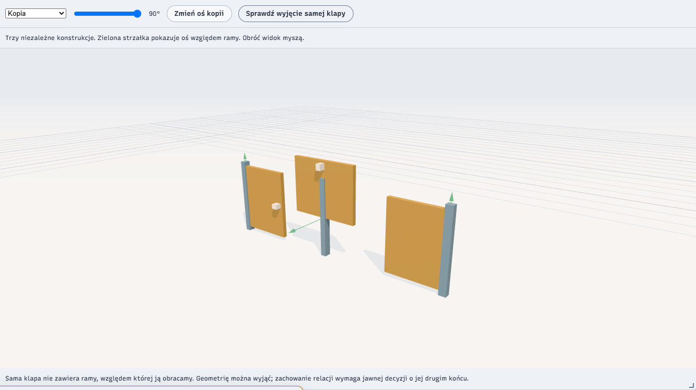

# Relacja przenoszona z konstrukcją

Mała próba badawcza, 21 października 2026. Przygotowana klapa obraca się względem ramy. Po skopiowaniu konstrukcji, obróceniu całego egzemplarza i zmianie osi jednej kopii relacja nadal dotyczy właściwych części. Nazwy wszystkich węzłów fixture są takie same: `cube`.

**Wynik dotyczy zachowania już podjętej decyzji. Interfejs nie pozwala autorowi zdefiniować własnej relacji na dowolnym modelu.** To nie jest edytor mechanizmów, fizyczny zawias ani integracja Ruchu z Jaskini v6.4. Nie proponujemy tego opakowania danych jako wspólnego formatu Studio. Kod można wykorzystać lub odrzucić niezależnie od Tworzywa.



## Co można tu sprawdzić

Wybierz egzemplarz i zmień kąt. Trzeci egzemplarz jest dodatkowo obrócony w scenie. Zmiana osi środkowej kopii nie zmienia pozostałych. Przycisk wyjęcia samej klapy pokazuje granicę: do przeniesienia tej relacji brakuje ramy. Kąt zerowy przywraca stan autorski; podgląd ruchu go nie nadpisuje.

Widok używa `Jaskinia.ext.type` i `swiat.stage/three` przypiętego hosta `dd47f3253dbcf522b4cd671c794599d32cbe79b9`. Nie tworzy nowej powłoki. Geometria jest syntetyczna, bez importera, plików autora i trwałego zapisu pracy.

## Odtworzenie

Z katalogu repo, Node 22+ i lokalny klon publicznego `Jozz-Cave-Workbench` zawierający przypięty commit:

```powershell
node --test experiments/material-as-construction/core.test.mjs experiments/material-as-construction/probes/relations/carriage.test.mjs
$env:JASKINIA_REPO='C:/path/to/Jozz-Cave-Workbench'
node experiments/material-as-construction/probes/relations/serve.mjs
```

Serwer wypisze adres localhost. Domyślnie wybiera wolny port; `PORT` pozwala go wskazać. Czyta host przez `git show`, bez zmiany checkoutu. Udostępnia tylko HTML hosta i cztery moduły eksperymentu. Adres zapisuje w lokalnym, ignorowanym `server.json`.

Do kontroli przeglądarkowej potrzebny jest Playwright i Chromium. Można użyć zależności nadrzędnego eksperymentu albo wskazać istniejące `PLAYWRIGHT_PACKAGE` (jego `package.json`) i `CHROMIUM_PATH` (plik wykonywalny). W drugim terminalu:

```powershell
node experiments/material-as-construction/probes/relations/verify.mjs
```

Test używa świeżego profilu, blokuje żądania poza własnym originem localhost i zapisuje `verification.json` oraz powyższy obraz. Nie korzysta z profilu użytkownika.

## Dokładny zakres dowodu

- `carriage.test.mjs`: **9/9**. Nowe identyfikatory części i relacji, niezależne kopie, dowolnie obrócony rodzic, zachowana przynależność poruszanych części po przepięciu, JSON i zmienione nazwy, granica częściowej ekstrakcji, odrzucenie nieobsługiwanych danych. Oczekiwane położenia punktów liczy oddzielny wzór Rodriguesa, nie funkcja obrotu implementacji. W recenzji wykryto przepełnienie normy osi; test odtworzył błąd i pozostał po naprawie.
- `verification.json`: **6/6** w izolowanym Chromium 151. Rzeczywiste kontrolki okna sterują widocznymi obiektami Three; sąsiednie egzemplarze pozostają niezmienione; powrót do pozycji spoczynkowej jest dokładny. Brak błędów strony i konsoli w tym przebiegu.
- Wyniki wcześniejszych 6 testów rdzenia i 20 kontroli Tworzywa opisuje nadrzędny eksperyment. Nie są testami integracji tej relacji z importerem ani Ruchem.

`captureRelated` przechwytuje istniejącą konstrukcję i relacje, których oba końce mieszczą się w wyborze. `insertRelated` zwraca jawne mapy nowych ID części i relacji. Pivot i oś są w układzie części bazowej. `poseRelated` oblicza podgląd względem stanu spoczynkowego i zwraca nowy dokument.

## Granice i warunek dalszego użycia

Próba obejmuje niezależne, pojedyncze obroty i sztywne transformacje. Odrzuca skalę, odbicie, ścinanie, sprzężone łańcuchy oraz kilka napędów tej samej gałęzi. Nie rozwiązuje fizyki, kontaktu, animacji, migracji importera ani ponownego dopasowania części do zmienionego źródła. To węższy zakres transformacji niż w rdzeniu Tworzywa.

Poruszana część nadal jest gałęzią **już utworzonej** konstrukcji. Test przepięcia zachowuje jej członków i ich tożsamość; nie dowodzi niezależności od dowolnego drzewa importu. Wyjęcie potomka, który nie zawiera żadnego końca relacji, daje statyczny fragment bez relacji. Przyszłe narzędzie autorskie musi wyraźnie pokazywać takie znaczenie operacji.

Najbliższy potrzebny sprawdzian jest inny niż kolejne kopiowanie tej klapy: autor sam wybiera części, bazę i oś w nieprzygotowanym modelu, poprawia decyzję, przenosi konstrukcję i wraca do niej. Należy sprawdzić tę drogę w rozwijanej powierzchni Jaskini. Jeśli potrzebuje kolejnego ręcznie napisanego fixture albo wynik osiąga równie prosto istniejące grupowanie, ta próba nie wykazała dodatkowej swobody twórczej i nie zasługuje na osobny moduł produktu.
